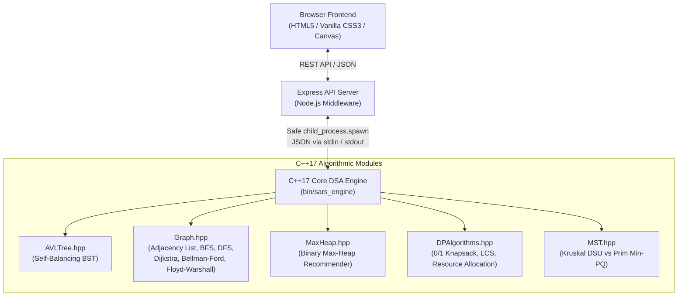

# 🎓 SARS // Smart Academic Recommendation System
### College DSA-II Capstone Project | Full-Stack Algorithmic Engine

[](https://en.cppreference.com/w/cpp/17)
[](https://nodejs.org/)
[](https://developer.mozilla.org/)
[](#-automated-testing-results)
[](LICENSE)

---

## 📌 Executive Summary

**Smart Academic Recommendation System (SARS)** is a college Data Structures & Algorithms II (DSA-II) project built from the ground up without third-party algorithm libraries, external black-box cloud AI, or paid APIs. 

All core decision models, graph traversals, balancing routines, and combinatorial optimizations are written in **pure C++17** and compiled as a standalone native binary (`sars_engine`). A lightweight **Node.js + Express** middleware layer executes the C++ engine safely via bidirectional JSON streaming, serving an interactive **Dark Navy & Cyan** academic dashboard with real-time graph visualizations and an interactive algorithmic laboratory.

---

## 🏛️ System Architecture



---

## 🧠 Core DSA Implementations & Theoretical Logic

### 1. Self-Balancing AVL Tree (`AVLTree.hpp`)
* **Purpose**: Course catalog storage, exact O(log N) lookup, in-order sorted traversal, and range filtering `[lowId, highId]`.
* **Balancing Invariant**: For every node $u$, the balance factor $\text{BF}(u) = \text{height}(u.\text{left}) - \text{height}(u.\text{right}) \in \{-1, 0, +1\}$.
* **Rotations**:
  * **Left-Left (LL)**: Single Right Rotation.
  * **Right-Right (RR)**: Single Left Rotation.
  * **Left-Right (LR)**: Left rotation on left child, followed by Right rotation on parent.
  * **Right-Left (RL)**: Right rotation on right child, followed by Left rotation on parent.

### 2. Academic Prerequisite Graph (`Graph.hpp`)
* **Representation**: Directed Adjacency List `unordered_map<string, vector<GraphEdge>>`.
* **Algorithms**:
  * **Breadth-First Search (BFS)**: Computes the unweighted shortest pathway minimizing the number of prerequisite semesters/edge hops ($O(V + E)$).
  * **Depth-First Search (DFS)**: Detects prerequisite cycles using recursion stack tracking (`recStack`) and produces a topological ordering for valid degree paths.
  * **Dijkstra's Algorithm**: Utilizes a Min-Priority Queue (`std::priority_queue<pair<double, string>>`) to compute the path with minimum total cognitive effort/workload weight ($O((V + E) \log V)$).
  * **Bellman-Ford Algorithm**: Relaxes all edges $V-1$ times to compute single-source shortest paths and checks for negative-weight cycles ($O(V \cdot E)$).
  * **Floyd-Warshall Algorithm**: Dynamic programming all-pairs shortest paths matrix formulation in $O(V^3)$:
    $$\text{dist}[i][j] = \min(\text{dist}[i][j], \text{dist}[i][k] + \text{dist}[k][j])$$
  * **Connected Components**: Identifies isolated academic tracks and independent degree clusters using BFS queue exploration.

### 3. Binary Max-Heap Course Recommender (`MaxHeap.hpp`)
* **Purpose**: Prioritizes eligible courses based on a transparent multi-criteria heuristic scoring model.
* **Heap Property**: For any index $i$, $\text{heap}[\text{parent}(i)] \ge \text{heap}[i]$, implemented with vector storage and custom `heapifyUp()` and `heapifyDown()` routines.
* **Transparent Scoring Heuristic**:
  $$\text{Score} = \text{TrackAlignment} (30) + \text{KeywordOverlap} (20) + \text{GPARigorFit} (25) + \text{PrereqReadiness} (15) + \text{BudgetBonus} (10)$$
* **Efficiency**: Extracts Top-$K$ recommendations in $O(K \log N)$ time, avoiding an $O(N \log N)$ total sort.

### 4. Dynamic Programming Suite (`DPAlgorithms.hpp`)
* **0/1 Knapsack Elective Optimizer**:
  * Enforces the student's elective credit budget $W$.
  * State: $dp[i][w]$ represents the maximum cumulative academic benefit using a subset of the first $i$ courses with total credits $\le w$.
  * Recurrence:
    $$dp[i][w] = \begin{cases} \max(dp[i-1][w], dp[i-1][w - \text{cr}_i] + \text{val}_i) & \text{if } \text{cr}_i \le w \\ dp[i-1][w] & \text{otherwise} \end{cases}$$
  * Backtracks through the 2D table to reconstruct the exact set of chosen courses.
* **Longest Common Subsequence (LCS)**:
  * Computes structural topic alignment between student career aspirations and course syllabi in $O(M \cdot N)$ time.
* **Resource Allocation Multi-Stage DP**:
  * Distributes $H$ weekly study hours across $N$ courses under diminishing marginal returns:
    $$\text{Gain}(i, h) = \text{DifficultyWeight}_i \cdot \log_2(1 + h) \cdot 12.0$$
  * Solved via multi-stage decision recurrence $dp[i][h] = \max_{0 \le k \le h} \{ dp[i-1][h-k] + \text{gain}(i, k) \}$.

### 5. Minimum Spanning Tree (`MST.hpp`)
* **Kruskal's Algorithm**: Greedily sorts edges and applies **Disjoint Set Union (DSU)** with path compression and union-by-rank to avoid cycles ($O(E \log E)$).
* **Prim's Algorithm**: Min-Priority Queue greedy cut-property edge expansion from an initial seed vertex ($O((V + E) \log V)$).
* Both algorithms are proven to produce identical total tree weight.

---

## ⏱️ Asymptotic Complexity Analysis

| Module / Algorithm | Time Complexity (Best) | Time Complexity (Worst) | Space Complexity | Real-World SARS Role |
| :--- | :---: | :---: | :---: | :--- |
| **AVL Tree Search** | $O(1)$ | $O(\log N)$ | $O(N)$ | Instant course lookup by course ID |
| **AVL Tree Insertion** | $O(\log N)$ | $O(\log N)$ | $O(N)$ | Self-balancing catalog construction |
| **AVL In-Order Traversal**| $O(N)$ | $O(N)$ | $O(N)$ | Alphabetically sorted catalog display |
| **BFS Shortest Path** | $O(1)$ | $O(V + E)$ | $O(V)$ | Pathway with fewest prerequisite hops |
| **DFS Cycle Detection** | $O(V + E)$ | $O(V + E)$ | $O(V)$ | Prerequisite integrity & topological sorting |
| **Dijkstra's Algorithm** | $O((V + E) \log V)$ | $O((V + E) \log V)$| $O(V)$ | Minimum cognitive effort learning path |
| **Bellman-Ford Algorithm**| $O(E)$ | $O(V \cdot E)$ | $O(V)$ | Arbitrary edge weights & negative cycle check |
| **Floyd-Warshall** | $O(V^3)$ | $O(V^3)$ | $O(V^2)$ | All-pairs academic distance matrix |
| **Max-Heap Extract-Max** | $O(1)$ | $O(K \log N)$ | $O(N)$ | Top-$K$ priority course recommendations |
| **0/1 Knapsack DP** | $O(N \cdot W)$ | $O(N \cdot W)$ | $O(N \cdot W)$ | Optimal elective bundle within credit limit |
| **LCS Syllabus DP** | $O(M \cdot N)$ | $O(M \cdot N)$ | $O(M \cdot N)$ | Student interest & syllabus keyword alignment|
| **Resource Allocation DP**| $O(N \cdot H^2)$ | $O(N \cdot H^2)$ | $O(N \cdot H)$ | Weekly study hour optimization across subjects |
| **Kruskal's Algorithm** | $O(E \log E)$ | $O(E \log E)$ | $O(V + E)$ | Core prerequisite backbone tree with DSU |
| **Prim's Algorithm** | $O(V \log V)$ | $O((V + E) \log V)$| $O(V + E)$ | Curriculum network growth from foundational root|

---

## 🧪 Automated Testing Results

SARS includes a test suite covering major algorithms, boundary values, empty graphs, disconnected components, and cycle detection:

```bash
$ cd cpp_engine && ./build.sh

============================================
  SARS C++17 Core DSA Automated Test Suite  
============================================
[RUNNING] AVLTree_Rotations_And_Balance ... PASSED
[RUNNING] AVLTree_EdgeCases ... PASSED
[RUNNING] Graph_BFS_And_Dijkstra ... PASSED
[RUNNING] Graph_Unreachable_And_Cycle_Detection ... PASSED
[RUNNING] Graph_BellmanFord_And_FloydWarshall ... PASSED
[RUNNING] MaxHeap_Operations ... PASSED
[RUNNING] CourseRecommender_PrerequisiteFilter ... PASSED
[RUNNING] Knapsack_ElectiveOptimization ... PASSED
[RUNNING] LCS_StringAlignment ... PASSED
[RUNNING] ResourceAllocation_DP ... PASSED
[RUNNING] MST_Kruskal_And_Prim_Equivalence ... PASSED

Summary: 11 / 11 test suites executed.
ALL 11 TESTS PASSED SUCCESSFULLY! ✓
```

---

## 🚀 Setup & Execution Guide

### Prerequisites
* **macOS** or **Linux**
* `clang++` or `g++` with **C++17 support**
* `Node.js` (v18+) & `npm`

### 1-Step Quick Start
Clone the repository and run the startup script:

```bash
git clone https://github.com/UtkarshGupta19/Smart-Academic-Recommendation-System.git
cd Smart-Academic-Recommendation-System
./run.sh
```

Open your browser at: **`http://localhost:3000`**

### Manual Step-by-Step Build

1. **Compile C++17 DSA Engine & Run Tests**:
   ```bash
   cd cpp_engine
   make all
   make test
   cd ..
   ```

2. **Install Server Dependencies**:
   ```bash
   cd server
   npm install
   ```

3. **Run API Integration Verification**:
   ```bash
   node test_api.js
   ```

4. **Start the Express Application**:
   ```bash
   npm start
   ```

---

## 🎯 Viva Examination Questions & Model Answers

### Q1: Why use an AVL Tree instead of an ordinary BST or Hash Map for courses?
> **Answer**: An ordinary BST degenerates to a linked list with $O(N)$ worst-case time when courses are inserted in order. The AVL Tree guarantees logarithmic height by enforcing balance factor $\in \{-1, 0, +1\}$ via 4 rotation cases (LL, RR, LR, RL), ensuring guaranteed $O(\log N)$ search and insertion. Unlike a Hash Map, the AVL Tree maintains sorted order, enabling in-order traversal and range searches (e.g., retrieving all courses between `CS200` and `CS400`) without sorting.

### Q2: Why compare BFS with Dijkstra for learning paths?
> **Answer**: BFS treats all edges as unweighted and discovers the path with the fewest edge hops (prerequisite stages, $O(V + E)$). However, some prerequisite paths contain demanding courses. Dijkstra's algorithm incorporates difficulty and credit workloads as edge weights, using a Min-Priority Queue ($O((V + E) \log V)$) to discover the path with the lowest cumulative difficulty score.

### Q3: How does the Max-Heap prioritize course recommendations?
> **Answer**: Candidate courses are evaluated against the student's completed courses, GPA, career interests, and credit limit. The composite score is pushed into a binary Max-Heap. Extracting the top-$K$ recommendations takes $O(K \log N)$ time, outperforming an $O(N \log N)$ full sort when $K \ll N$.

### Q4: Explain the 0/1 Knapsack formulation for elective optimization.
> **Answer**: Each elective has an integer credit requirement (weight) and a calculated academic relevance score (value). The student's credit budget represents the capacity $W$. Because each course can only be taken once, the problem exhibits optimal substructure and overlapping subproblems:
> $$dp[i][w] = \max(dp[i-1][w], dp[i-1][w - \text{credits}_i] + \text{value}_i)$$
> The solution is reconstructed by backtracking through the DP table in $O(N \cdot W)$ time.

### Q5: What is the operational difference between Kruskal's and Prim's MST?
> **Answer**: Kruskal's algorithm is edge-centric: it sorts all edges and uses Disjoint Set Union (DSU) with path compression and union-by-rank to prevent cycles ($O(E \log E)$). Prim's algorithm is vertex-centric: it starts from a seed vertex and grows a tree using a Min-Priority Queue to pick the minimum cut-edge ($O((V + E) \log V)$). Both yield the same minimum total weight.

---

## 📁 Repository Structure

```
Smart-Academic-Recommendation-System/
├── cpp_engine/                     # Core C++17 DSA Engine
│   ├── include/
│   │   ├── AVLTree.hpp             # Self-balancing AVL Tree implementation
│   │   ├── Course.hpp              # Course data model with JSON serialization
│   │   ├── DPAlgorithms.hpp        # 0/1 Knapsack, LCS, Resource Allocation DP
│   │   ├── Graph.hpp               # Graph: BFS, DFS, Dijkstra, Bellman-Ford, Floyd-Warshall
│   │   ├── MaxHeap.hpp             # Binary Max-Heap priority recommender
│   │   ├── MST.hpp                 # Kruskal (DSU) and Prim MST algorithms
│   │   └── json.hpp                # Modern C++ JSON single-header library
│   ├── src/
│   │   └── main.cpp                # CLI Engine processing JSON commands via stdin
│   ├── tests/
│   │   └── test_suite.cpp          # Automated unit test suite (11 test suites)
│   ├── Makefile                    # Clang++ C++17 build rules
│   └── build.sh                    # Build and test shell script
├── server/                         # Express API Backend
│   ├── data/
│   │   ├── courses.json            # Course catalog with prerequisites and tracks
│   │   └── students.json           # 4 diverse sample student profiles
│   ├── server.js                   # Safe child_process spawn bridge & REST API
│   ├── test_api.js                 # API and engine integration test suite
│   └── package.json                # Express and CORS dependencies
├── public/                         # Modern Academic-Tech Web Frontend
│   ├── index.html                  # Responsive multi-tab dashboard layout
│   ├── styles.css                  # Dark Navy & Cyan design system
│   └── app.js                      # Canvas visualizer and lab controller
├── run.sh                          # 1-click startup script
├── package.json                    # Workspace npm scripts
├── .gitignore                      # Git ignore rules
└── README.md                       # Complete project documentation
```

---

## 👤 Author
* **Utkarsh Gupta** ([@UtkarshGupta19](https://github.com/UtkarshGupta19))
* College DSA-II Capstone Project
